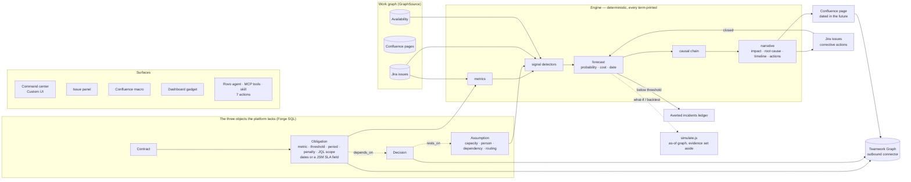

# Antemortem

> Antemortem writes your post-mortems before the incidents happen — then helps you make sure they never get written for real.

An Atlassian Forge app for Jira, Confluence and Rovo. It gives an organisation three objects the platform does not have — contractual **obligations**, **decisions with the assumptions they rest on**, and the **causal links** between them and the work — and an explainable engine that, when a breach becomes likely, writes the post-mortem of that incident in Confluence, dated in the future, with every line linked to evidence that exists today. Corrective actions become Jira issues; when they bring the forecast down, the page archives itself under *Averted incidents* with the penalty it avoided.

- **Project book (French):** [BUILD.md](BUILD.md) — concept, architecture, data model, engine, demo scenario, plan.
- **For judges (English):** [JUDGE_INSTRUCTIONS.md](JUDGE_INSTRUCTIONS.md) — install and test in 10 minutes.
- **Platform surfaces:** Jira global page (Custom UI), issue panel, dashboard gadget, Confluence macro, Rovo agent with 7 actions, the same actions as **MCP tools** (`rovo:mcp`), a **skill** for Rovo Studio agents (`rovo:skill`), an outbound **Teamwork Graph connector** that publishes obligations, decisions and projected incidents as searchable documents, a web trigger, an hourly schedule.
- **What it does, in one screen:** obligations, decisions with typed assumptions, an explainable forecast, a post-mortem published in the future, what-if and history on the causal chain, a portfolio across contracts, an issue panel, a Confluence macro and a Rovo agent that proposes decisions from pages.
- **Video plan:** [DEMO_SCRIPT.md](DEMO_SCRIPT.md). **History:** [CHANGELOG.md](CHANGELOG.md). **Out of scope:** [BACKLOG.md](BACKLOG.md).

## Develop

```bash
npm install && npm run install:ui
npm test                      # 59 tests, offline, on the demo scenario
npm run deploy:dev            # build the UI + forge deploy (development); deploy:prod for production
forge install --upgrade --non-interactive -e development --site <site>.atlassian.net --product jira
forge install --upgrade --non-interactive -e development --site <site>.atlassian.net --product confluence
```

Design the command center without Jira: `cd static/command-center && npm run dev`, then open the dev URL with `?mock=1`.

## Layout

```
manifest.yml                 Forge modules, scopes, runtime
resource/agent/prompt.txt    Rovo agent prompt
src/index.js                 function entry points
src/resolvers/               Custom UI resolvers (admin guard on writes)
src/triggers/                install / hourly / webtrigger
src/rovo/                    Rovo actions
src/frontend/                UI Kit: issue panel, Confluence macro, dashboard gadget
src/db/                      Forge SQL: migrations, runner, repositories
src/graph/                   GraphSource abstraction (REST today, Teamwork Graph later)
src/engine/                  metrics → signals → chain → forecast → narrative → publish
src/jira/ src/confluence/    REST clients
src/demo/                    demo scenario, async loader, reset
static/command-center/       React 18 + Vite command center (mock mode for design)
test/                        node --test, with an in-memory graph source
```

## How it works



**One analysis run** (`src/engine/index.js`, hourly, on demand, or from the web trigger): for each active obligation, `issuesInScope(jql)` → `computeMetric` → direct detectors (trend, stale critical issue, single point of failure, silent assignee) → `checkAssumption` for each assumption of the decisions it depends on → `computeForecast` (a transparent sum, bounded 0.05–0.98) → `buildChain` (dated evidence, root decision first) → `reconcileIncident`: publish when the probability crosses the threshold, update while it stays above, avert when it drops, reinstate when it comes back, materialize when the period closes breached.

**What is deliberately not here**: a language model in the engine. Rovo is used only at the edges — the agent answers from the engine's data, and proposes decisions or obligations read from a page for the user to confirm.

**Constraints that shaped the code**: Forge SQL is provisioned per installation (the Confluence macro reads the published pages rather than the Jira installation's database); resolvers have 25 s (publication runs in an async-events consumer); no foreign keys, no auto-increment (UUIDs, idempotent migrations re-checked hourly).

## Security model

- Every Jira/Confluence call is made as the app, except the checks that must be the user's: writes from the UI and from the Rovo agent require Jira **administrator** (`mypermissions`, as user, fail closed); the agent reads a Confluence page **as the calling user**; a JQL scope recorded through the agent must run for that user first; the issue panel answers only about issues the caller can open.
- The web trigger accepts the token in a header only, compares it in constant time, and never queues a second analysis while one runs.
- Only `https://` URLs are stored as sources (they end up in `href` attributes); everything written to Confluence storage format goes through one escaper.
- SQL is always prepared with bound parameters; column names come from an allow-list.
- No egress: no `permissions.external`, no remotes, no external scripts or fonts. Forge storage only.
- The Teamwork Graph connector publishes with `replicatesPermissions: false` on purpose: the documents it emits are the app's own summaries (an obligation, a decision, a projected incident), visible to the same people as the command center, and they name people only through the Jira issues they link to. Per-document permissions would add nothing the Jira and Confluence links do not already enforce.
- `manage:jira-configuration` and `write:confluence-space` exist only for the demo loader (create/delete the demo project and space).

A white-box review (scopes, authz, injection, storage escaping, web trigger, tenant isolation) was run before submission; the two findings it produced — agent page reads as app, agent writes without the admin check — are fixed above.

## Things learned the hard way

- `FIELD` is a reserved JQL word; always quote project keys in JQL.
- Jira's create-link API: `{ inwardIssue: A, outwardIssue: B, type: Blocks }` reads "A blocks B"; the read side on issue X lists `outwardIssue` for "X blocks Y".
- After deleting and recreating a project with the same key, `key in (...)` can return the old issues; read issues directly by key.
- Forge SQL: `timeoutSeconds` only on scheduled triggers and consumers; `id: undefined` in a spread clobbers a generated id; `SIGNAL` is a reserved table name.
- Forge Custom UI blocks `window.confirm`; `@forge/bridge` throws at import outside a product.
- Forge SQL and KVS are provisioned **per installation**: the Confluence install of the app cannot read what the Jira install stored. The Confluence macro therefore reads the published pages, not the database.
- A React hook that ends up inside an effect (bad merge) renders a blank iframe with no error in the parent console; the mock page hides it by luck of ordering.
- Corrective actions that merely exist must not lower the forecast, or publishing an incident averts it by itself on the next hourly run.
